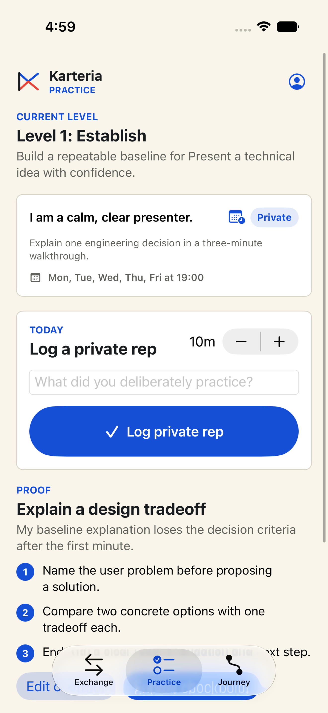

# Karteria

An iPhone prototype for deliberate practice. Set a goal, do a two-minute rep, and submit one piece of evidence when you are ready for review.

**[Run locally](#run-locally)** · [Review rule](#the-review-rule) · [Privacy and safety](docs/PRIVACY_AND_SAFETY.md)



## The review rule

Daily practice stays private. A checkpoint is verified after two of three calibrated anonymous peers independently confirm all three observable criteria. A review can give useful feedback and still leave the checkpoint unverified. The domain tests cover the practice and review rules.

## Product boundary

- `Exchange`: anonymous, evidence-first review. No feed, likes, follows, chat, rankings, or AI votes. Reviewers can report content or hide future proof from an opaque anonymous owner.
- `Practice`: private goals, scheduled reps, two-minute fallback, evidence contracts, and submission preflight.
- `Journey`: a private timeline of evidence, verified levels, and before/after progress.
- Members aged 13 to 17 use private practice plus invite-only CloudKit trusted review. It gives advisory feedback only and cannot unlock an anonymous Level, grant credits, or change a 2-of-3 settlement.
- AI is an optional on-device preflight on iOS 27. It can flag missing coverage; it never creates, changes, or substitutes a peer vote.

## Repository layout

| Path | Purpose |
| --- | --- |
| `Karteria/` | Native SwiftUI iOS application, deployment target iOS 18. |
| `KarteriaTests/` | Domain rules for practice, reviews, credits, and Community Pro Pass. |
| `Workers/` | Cloudflare Worker source for the anonymous exchange. |
| `CloudKit/public-schema.json` | Version-controlled declarative public database schema. |
| `docs/` | Setup, privacy, release, and Shipaton submission guidance. |

## Run locally

Open `Karteria.xcodeproj`, select the `Karteria` scheme, and choose an installed iOS 18+ simulator. Start with private practice. Anonymous exchange and trusted review require the respective Worker and CloudKit configuration.

```bash
# Replace the placeholder with the UDID of a simulator installed on your Mac.
xcodebuild -project Karteria.xcodeproj -scheme Karteria \
  -destination 'platform=iOS Simulator,id=<installed-simulator-udid>' test

# Worker source only; this does not log in to or deploy Cloudflare
cd Workers
npm ci
npm run check
npm test
```

## Configuration state

The repository intentionally contains no Apple, CloudKit, Cloudflare, or RevenueCat secret. Release builds use the public `KARTERIA_WORKER_URL`; the Worker keeps CloudKit and RevenueCat credentials in Cloudflare secrets. If the Worker is unavailable, anonymous submission fails closed while private practice remains fully usable. Evidence owners can remove their public raw proof, trusted-share owners can revoke an invite, and full private-data deletion stops if remaining remote copies cannot be verified and removed. Read [CloudKit setup](docs/CLOUDKIT_SETUP.md), [Worker setup](docs/WORKER_SETUP.md), and [RevenueCat setup](docs/REVENUECAT_SETUP.md) before changing the deployment.

The production CloudKit schema, Cloudflare Worker, App Store Connect app, and RevenueCat project are configured outside Git. No billing account or payment method is required by the deployed Worker architecture.
